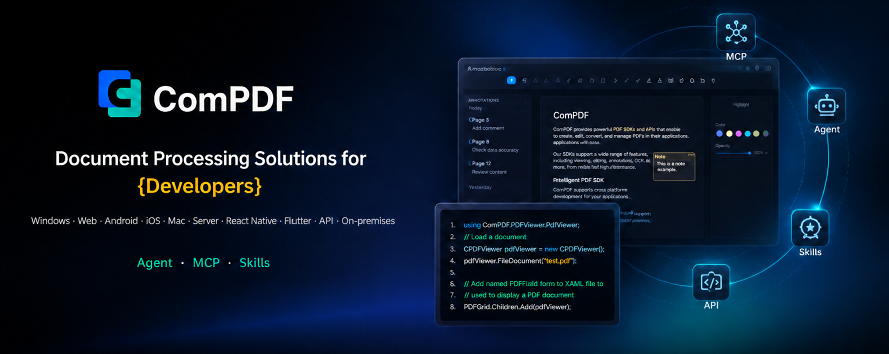

[English](README.md) | [繁體中文](README_TW.md) | [日本語](README_JA.md) | [简体中文](README_CN.md)

# ComPDF Generation - オープンソース PDF ドキュメント生成 SDK

**ComPDF Generation** は KDAN エコシステムの一部として提供される、開発者および企業システム向けのオープンソース PDF ドキュメント生成 SDK です。契約書、請求書、レポート、証明書などの自動文書生成に対応し、出力品質、導入しやすさ、そして商用運用への拡張性を両立します。

> - ComPDF Generation がプロジェクトに役立ったら、GitHub でぜひ ⭐ **Star** をお願いします。
> - ご質問、ご要望、想定ユースケースなどがあれば、**[Issues](https://github.com/ComPDFKit/compdf-generation/issues)** や **[Discussions](https://github.com/ComPDFKit/compdf-generation/discussions)** からお気軽にお知らせください。

<p align="center">
  <a href="#"></a>
  <a href="#"></a>
  <a href="#"></a>
</p>

<p align="center">
  <a href="#compdf-generation-を選ぶ理由"><b>ComPDF Generation を選ぶ理由</b></a> •
  <a href="#主な機能"><b>主な機能</b></a> •
  <a href="#クイックスタート"><b>クイックスタート</b></a> •
  <a href="#商用版へのアップグレードが適しているケース"><b>商用版への移行</b></a> •
  <a href="#利用シーン"><b>利用シーン</b></a> •
  <a href="#compdf-generation-と他のオープンソース-pdf-ライブラリの比較"><b>比較</b></a> •
  <a href="#ライセンス"><b>ライセンス</b></a> •
  <a href="#サポート"><b>サポート</b></a>
</p>

## ComPDF Generation を選ぶ理由

**ComPDF Generation** は、**業務文書生成** における導入効率とテンプレート再利用性の向上に特化しています。ビジュアルテンプレートエディタとリアルタイムプレビューにより、コードを書かずにテンプレートの作成と出力確認が可能です。さらに API も提供しているため、テンプレートベースの文書生成ワークフローを自動化しやすくなります。

### 主な特長

- 契約書、請求書、レポート、証明書などの業務文書に対応
- HTML テンプレートを使った PDF 生成をサポート
- 生成数の制限がなく、マルチスレッド処理で大量生成にも対応
- AI Agent によるドキュメント自動生成を実現し、モデル推論時の Token 消費を最適化します。
- AGPL のオープンソースとして、迅速な検証や導入が可能
- 商用 License を用意しており、本番環境やエンタープライズ運用へスムーズに移行可能

## 主な機能

| 機能                       | 説明                                                                                                                                                                                 |
| ------------------------ | ---------------------------------------------------------------------------------------------------------------------------------------------------------------------------------- |
| HTML テンプレートから PDF 生成     | HTML テンプレートをもとに PDF を生成し、マルチスレッドによる一括生成にも対応                                                                                                                                        |
| テンプレートエディタ               | ノーコードかつビジュアルに、契約書・請求書・レポート・証明書テンプレートを設計可能                                                                                                                                          |
| テンプレート管理                 | テンプレートの管理と再利用を支援し、重複開発を削減                                                                                                                                                          |
| テンプレートと JSON データによるプレビュー | テンプレート検証と最終 PDF 出力確認を効率化                                                                                                                                                           |
| テンプレート要素                 | ComPDF Generation は、テキスト、表、画像、ハイパーリンク、ヘッダー・フッター、ページ番号、バーコード、CSS スタイル、動的変数・計算、ループ／条件分岐ロジック、PDF フォーム、ビジュアルテンプレート編集など、主要な PDF 生成要素をサポートしています。複雑なビジネス文書のテンプレートベース生成や動的ドキュメント生成に対応できます。 |


## クイックスタート

### 事前準備

- Windows または macOS の場合は Docker Desktop、Linux の場合は Docker Engine と Docker Compose plugin を用意してください
- Docker Hub から `compdfkit/compdf-app:1.0.0` イメージを取得できること

### プロジェクトの取得

リポジトリを clone して、プロジェクトディレクトリに移動します。

```bash
git clone https://github.com/ComPDFKit/compdf-generation.git
cd compdf-generation
```

### 設定と起動

このプロジェクトには .env.example にトライアル License があらかじめ含まれています。デプロイ前にこのファイルをコピーして設定を完了すると、トライアル License を利用できます。

なお、トライアル License で生成された PDF には透かしが入ります。本番環境で透かしなしの PDF を生成する場合は、[営業窓口へお問い合わせ](https://www.compdf.com/zh-cn/contact-sales?utm_source=github_generation_newopen&utm_medium=referral&utm_campaign=generation_open&ref_platform_id=github_compdf_ja)いただき、正式な商用 License を取得のうえ COMPDF_LICENSE_KEY を差し替えてください。

```powershell
# Windows PowerShell
Copy-Item .env.example .env
```

```bash
# macOS または Linux
cp .env.example .env
```

サービスを起動します。

```bash
docker compose up -d --build
docker compose ps
```

`compdf-app` の状態が `healthy` になったら、`http://localhost:8090` を開いてください。リモート Linux サーバーへデプロイする場合は、そのサーバーの `8090` ポートへアクセス可能なブラウザから同じ URL を開いてください。

### 環境変数

サービス起動前に、`.env` で以下の変数を設定できます。

| 変数                      | 既定値                     | 説明                                                                                                   |
| ----------------------- | ----------------------- | ---------------------------------------------------------------------------------------------------- |
| `COMPDF_LICENSE_KEY`    | 必須                      | PDF Generation または HTML to PDF 権限を持つ ComPDF License Key。`.env.example` の試用 Key で生成した PDF には透かしが入ります。 |
| `COMPDF_IMAGE_PLATFORM` | `linux/amd64`           | `compdf-app` イメージで使用するプラットフォーム。対象ホストで対応している場合のみ変更してください。                                             |
| `NODE_IMAGE`            | `node:22-bookworm-slim` | Web / API サービスの Docker マルチステージビルドで使用する Node.js イメージ。                                                 |
| `APP_PORT`              | `8090`                  | ComPDF Generation の Web UI と API を公開するポート。`8090` が使用中の場合は別の空きポートへ変更してください。                           |
| `COMPDF_TIMEOUT_MS`     | `120000`                | Web/API サービスが ComPDF エンジンの応答を待つ最大時間（ミリ秒）。大きなテンプレートや複雑なテンプレートでは調整してください。                              |
| `TEMPLATE_STORAGE_DIR`  | `./data/templates`      | HTML テンプレート、JSON データソース、メタデータを永続化するホスト側ディレクトリ。固定保存先が必要な場合は絶対パスを指定してください。                             |

### デプロイ確認

```bash
docker compose ps
docker compose logs --tail=100 compdf-generation compdf-app
```

両サービスが起動しており、`compdf-app` が `healthy` になってから PDF を生成できます。別デバイスからアクセスさせる場合は、サーバーのファイアウォールまたはセキュリティグループで `APP_PORT`（既定値 `8090`）への TCP 受信を許可してください。

### テンプレート作成と PDF 生成

1. テンプレート一覧で新規テンプレートを作成し、名前と説明を入力します。
2. テンプレートエディタを開き、HTML コンテンツを作成します。
3. 必要に応じて JSON データを追加し、テンプレートを保存します。
4. エディタ内で PDF を生成すると、ブラウザからファイルをダウンロードできます。

テンプレートは `TEMPLATE_STORAGE_DIR` に保存され、既定値は `./data/templates` です。アプリケーションコンテナを再構築しても、これらのデータは削除されません。

## 商用版へのアップグレードが適しているケース

本番環境での利用、透かしなし出力、または企業向けサポートが必要な場合は、[商用版](https://www.compdf.com/contact-sales?utm_source=github_generation_newopen&utm_medium=referral&utm_campaign=generation_open&ref_platform_id=github_compdf_ja)へのアップグレードをご検討ください。

| 項目                  | オープンソース版   | 商用版        |
| ------------------- | ---------- | ---------- |
| 文書生成 API            | ✅          | ✅          |
| HTML テンプレート設計とインポート | ✅          | ✅          |
| テンプレート管理            | ✅          | ✅          |
| 一括生成                | ✅          | ✅          |
| 透かしなし出力             | 透かしあり      | 透かしなし      |
| 本番環境利用              | 非推奨        | ✅          |
| SLA / 技術サポート        | コミュニティサポート | 専任サポート     |
| License             | AGPL v3    | 商用 License |

## 利用シーン

- **契約書の自動生成**: 売買契約、調達契約、利用規約などを自動で作成・差し込みし、締結までのリードタイムを短縮します。
- **請求書や帳票の自動生成**: 業務データと連携し、請求書、精算書、明細書などを自動生成して手作業ミスを削減します。
- **レポートの一括生成**: 月次レポート、四半期レポート、分析レポートなどを大量出力し、高頻度業務に対応します。
- **証明書・各種証票の生成**: 在職証明書、学位証明書、資格証明書など、定型文書を迅速に作成できます。
- **社内システム向け PDF 出力**: CRM、ERP、OA などの企業システムと連携し、申請書や業務帳票を必要に応じて PDF 化できます。

## ComPDF Generation と他のオープンソース PDF ライブラリの比較

| 観点       | ComPDF Generation                      | 他の PDF ライブラリ             |
| -------- | -------------------------------------- | ------------------------ |
| 製品の位置付け  | 業務文書生成に特化し、用途別テンプレートを簡単にカスタマイズ可能       | 低レイヤーの PDF 機能をラップしたものが中心 |
| 文書生成能力   | 一括生成に対応し、生成数の制限なし                      | 一定の制約があることが多い            |
| 想定シーン    | 契約書 / 請求書 / レポート / 証明書                 | 汎用描画やレイアウト               |
| テンプレート活用 | ノーコードのビジュアル HTML テンプレート編集、インポート、再利用に対応 | 独自実装が必要                  |
| 商用拡張性    | 商用版へスムーズに移行可能                          | 拡張要件は自前で補うケースが多い         |

## ライセンス

- 本プロジェクトのオープンソース部分は **GNU Affero General Public License v3.0** のもとで提供されています。
- クローズドソースの商用プロジェクト、本番環境、または企業向け提供で利用する場合は、**商用 License** を申請してください。
- 詳細はリポジトリ内の [LICENSE](LICENSE) を参照してください。

## サポート

ご質問やご要望がありましたら、以下をご利用ください。

- [Issue](https://github.com/ComPDFKit/compdf-generation/issues) を登録する
- [Discussions](https://github.com/ComPDFKit/compdf-generation/discussions) に参加する
- [ComPDF チームへお問い合わせ](https://www.compdf.com/contact-sales?utm_source=github_generation_newopen&utm_medium=referral&utm_campaign=generation_open&ref_platform_id=github_compdf_ja)いただき、商用 License を取得する

ComPDF Generation がプロジェクトに役立ったら、ぜひ ⭐ **Star** をお願いします。

---

<p align="center">
  <b>ComPDF チームが提供しています。</b><br>
  <a href="https://www.compdf.com/?utm_source=github_generation_newopen&utm_medium=referral&utm_campaign=generation_open&ref_platform_id=github_compdf_ja">公式サイト</a> ·
  <a href="https://www.compdf.com/contact-sales?utm_source=github_generation_newopen&utm_medium=referral&utm_campaign=generation_open&ref_platform_id=github_compdf_ja">商談・お問い合わせ</a> ·
  <a href="https://www.compdf.com/guides/generation-sdk/java/overview?utm_source=github_generation_newopen&utm_medium=referral&utm_campaign=generation_open&ref_platform_id=github_compdf_ja">ドキュメント</a>
</p>
